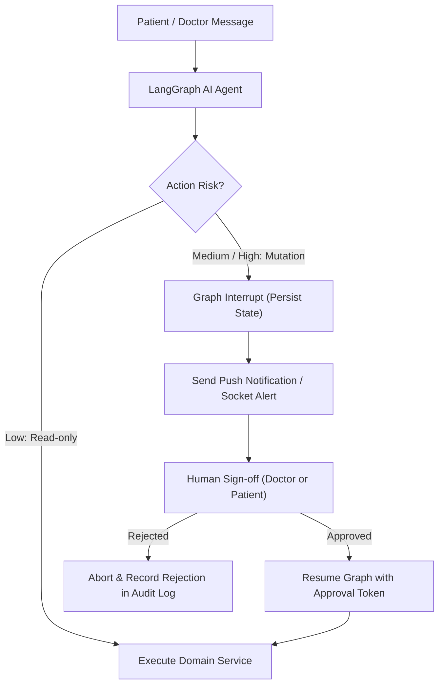

# Quick-Clinic Doctor AI Agent — Architecture & Integration Design

This document specifies the architecture, boundaries, security controls, and database persistence requirements for the upcoming LangGraph-based Doctor AI Agent in Quick-Clinic.

---

## 1. Core Principles & System Boundaries

1. **Strict Service Layer Reuse**: The AI Agent must **never execute direct SQL queries** or manipulate database tables directly. All actions must invoke the validated, transaction-safe domain services (`scheduling`, `booking`, `documents`, `patients`).
2. **Deterministic & Read-Only Inquiries**: Queries checking doctor schedules, slot availability, and clinic information are strictly read-only and will never alter database states.
3. **Idempotency for Mutating Actions**: Any agent action that reserves slots, creates appointments, or processes payments must supply a client-generated or conversation-deterministic `idempotency_key`.
4. **Zero Production Payments**: The AI agent will never initiate unapproved financial transactions.

---

## 2. Tool Boundaries & Interfaces

The interfaces defined in [`backend/app/features/ai_agent/interfaces.py`](file:///Users/karanagg/Desktop/Projects/Quick-Clinic/backend/app/features/ai_agent/interfaces.py) govern tool access:

| Tool Interface | Target Capability | Permitted Roles | Risk Tier |
|---|---|---|---|
| `DoctorSchedulingToolInterface.get_available_slots` | Inspect open consultation slots | Any authenticated active user | `LOW_AUTONOMOUS` |
| `DoctorSchedulingToolInterface.get_doctor_schedule` | Read weekly working hours | Any authenticated active user | `LOW_AUTONOMOUS` |
| `AppointmentActionToolInterface.reserve_slot` | Acquire 10-minute hold on a slot | `PATIENT` | `MEDIUM_HUMAN_APPROVAL` |
| `AppointmentActionToolInterface.cancel_appointment` | Cancel visit with auto-refund | `PATIENT`, `DOCTOR`, `ADMIN` | `MEDIUM_HUMAN_APPROVAL` |
| `ClinicalDocumentsToolInterface.list_patient_documents` | List medical history records | Record owner (`PATIENT`) or `DOCTOR` with confirmed visit | `HIGH_CLINICAL_RESTRICTED` |

---

## 3. Human-in-the-Loop (HITL) Approval Architecture

High-stakes actions cannot complete purely via autonomous agent execution. The LangGraph graph must pause execution (`interrupt`) until human sign-off is recorded:

### Approval Safeguards:
- **Time-to-Live (TTL)**: Unapproved pending actions expire automatically after 15 minutes.
- **Bi-directional Verification**: Clinical cancellations or slot changes initiated by the agent require affirmative confirmation from both affected parties where applicable.
- **Immutable Audit**: All proposals, approvals, rejections, and execution timestamps are committed to `AuditLog`.

---

## 4. PostgreSQL Checkpoint Persistence

LangGraph workflows require durable checkpoints so that multi-turn dialogs and interrupted HITL approvals survive backend restarts without state loss.

### Persistence Engine:
- Utilizes `langgraph-checkpoint-postgres` (`AsyncPostgresSaver`).
- Points to the existing Supabase session pooler connection string.
- Connection pool limits are constrained (`max_size: 3`) to ensure compatibility with free-tier connection ceilings.

### Checkpoint Schema:
1. `checkpoints`: Thread identifier, state version, and serialized graph memory.
2. `checkpoint_blobs`: Arbitrary binary/JSON state blobs.
3. `checkpoint_writes`: Pending outbox writes and state transitions.
4. `checkpoint_migrations`: Version tracking.

---

## 5. Security & Privacy Safeguards

- **No Medical Data in Prompts/Logs**: Clinical documents are referenced by immutable identifiers (`document_id`). Raw medical files are never piped into generic LLM logs or traces.
- **Fail-Safe Revocation**: If a user's `isActive` flag is flipped to `false`, all active agent threads and socket connections are immediately disconnected.
